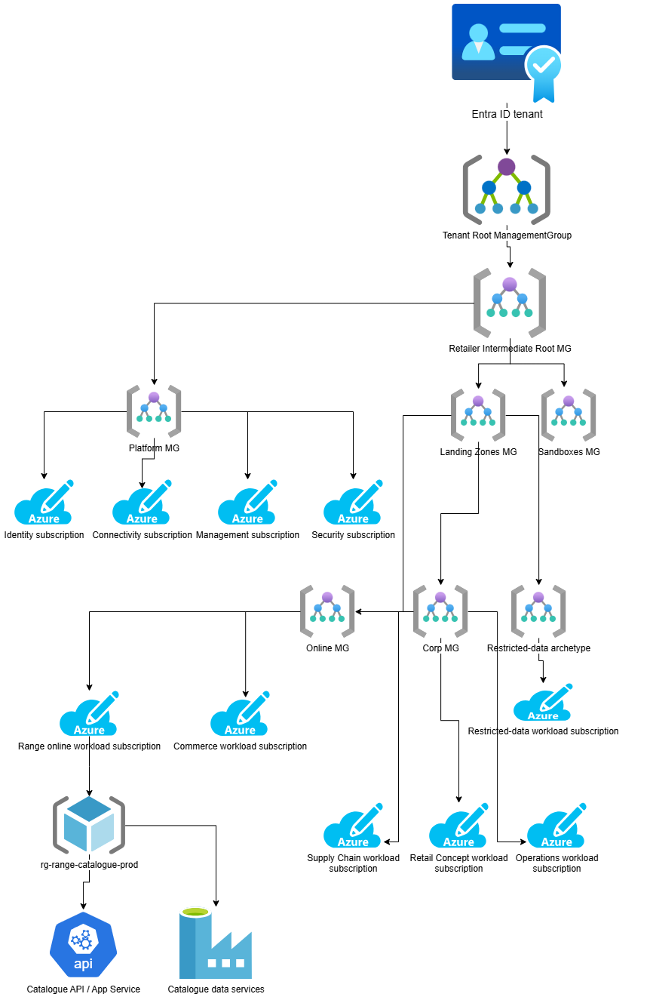

# Enterprise Governance and Subscription Hierarchy

Tenant root and intermediate root
- The enterprise governance boundary.
- High-level mandatory policy and administrative controls.
- Delegated ownership of the retailer's Azure hierarchy.

---
Platform management group
- sub-platform-identity-prod
- sub-platform-connectivity-prod
- sub-platform-management-prod
- sub-platform-security-prod

> These are example subscription names. In a large enterprise, identity-related resources may be integrated into other platform subscriptions rather than requiring a dedicated subscription; the boundary should follow the operating model.
---
---

Landing Zones management group
- mg-online
- mg-corp
- Optional restricted-data archetype where separate inherited controls are justified.

> The restricted-data archetype shown here is a deliberate customization, not a mandatory default Azure management group. If the requirements can be satisfied through policy assignments, workload subscriptions and RBAC without another management group, keep the hierarchy simpler.

---
---

The important distinction: business unit versus governance
A business unit owns its products and applications. A landing-zone archetype determines which guardrails and connectivity model apply.

For example:
- Range Catalogue API -> Online.
- Supply Chain warehouse service -> Corp.
- Retail Concept planning application -> Corp.
- Operations store-management application -> Corp.
- A sensitive cross-business customer-data service -> restricted-data archetype if its requirements justify stronger inherited controls.

> The actual workload ownership should be represented by subscription assignments, resource ownership and catalog metadata—not by creating a different management group for every team by default.

---
---
