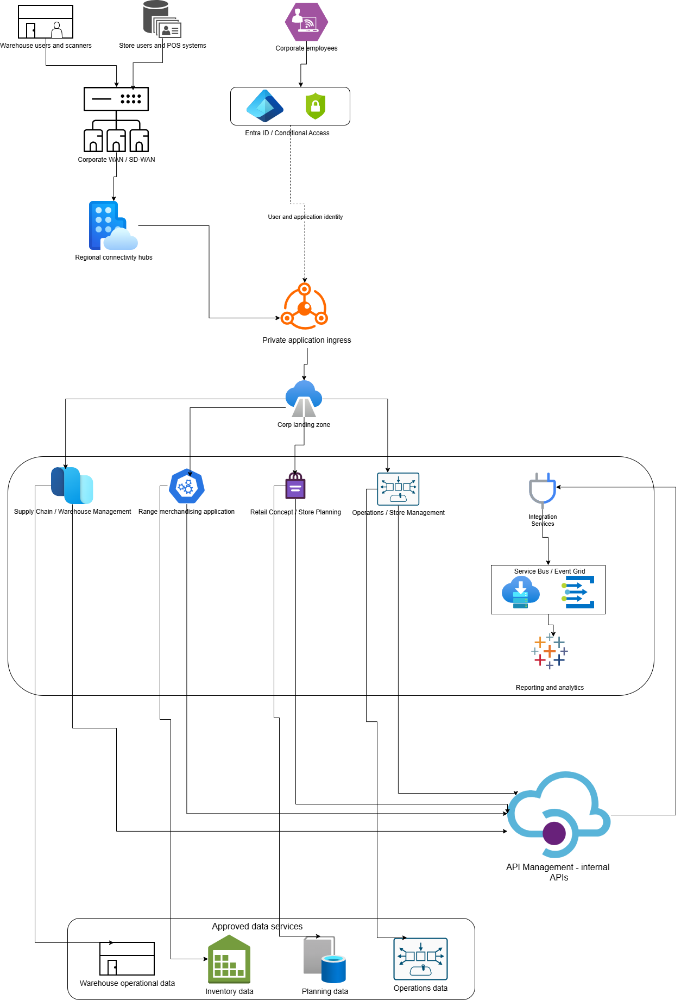

# Internal Workloads And Business Unit Flows

### internal applications and the four business units

How the business flows connect
- Range: owns product catalogue, category, merchandising and product metadata. It consumes approved inventory feeds from Supply Chain.
- Supply Chain: manages warehouse operations, stock movement and replenishment. Store and warehouse connectivity is restricted to the required endpoints.
- Retail Concept: manages store layouts, concepts and planning data; it consumes approved catalogue and operational information.
- Operations: manages store operational workflows and may integrate with store systems, reporting and approved external services.

---

