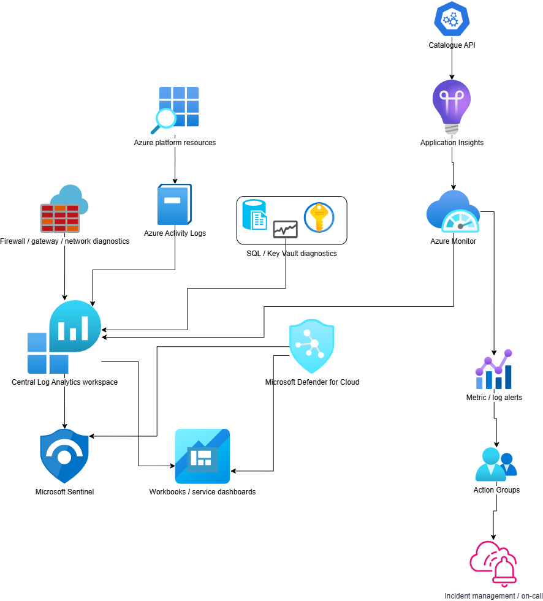

# Observability and Security Operations

### Centralized monitoring, security and operational management

| Capability | Operational responsibility |
|---|---|
| Availability monitoring | Detect failed health checks, elevated errors and unhealthy dependencies |
| Performance monitoring | Monitor p95/p99 latency, throughput, database timing and resource saturation |
| Platform diagnostics | Collect relevant firewall, gateway, platform and resource logs |
| Security monitoring | Review Defender for Cloud findings, identity signals and suspicious activity |
| SIEM/SOAR | Correlate security events and automate approved responses where Sentinel is deployed |
| Incident management | Assign severity, ownership, escalation and communication |
| Cost management | Track resource spend, budgets, forecasts and business-unit allocation |
| Configuration compliance | Evaluate policy compliance and track approved exemptions |
| Service ownership | Maintain service catalog, runbooks, dependencies and operational contacts |

---
---

