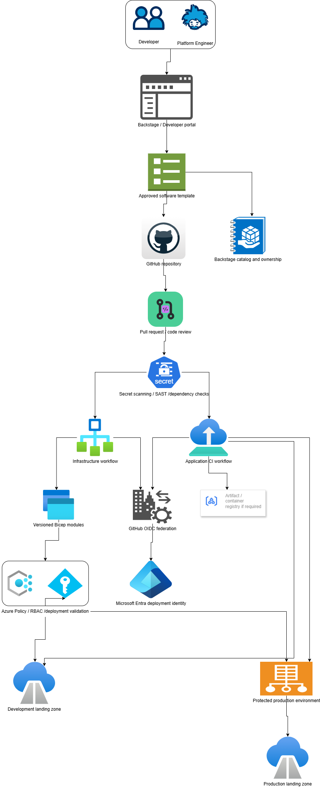

# Platform Engineering and Delivery

### GitHub, Bicep, Backstage and secure deployment

Backstage → GitHub
- Generate repository from an approved template.
- Add catalog metadata, CODEOWNERS and workflow definitions.
- Apply repository and branch protection settings.
- Record the service owner, business unit, data classification and environment.
---
GitHub → Azure authentication
- Use OIDC workload federation.
- Restrict the federated credential to the intended repository and environment.
- Separate identities and permissions for infrastructure and application deployments.
- Use protected production environments and approval gates.
---
Bicep → Azure
- Run lint, validation and what-if.
- Apply modules at the intended scope.
- Validate policy compliance and role assignments.
- Capture deployment outputs and resource identifiers.
- Use a controlled rollback or forward-fix procedure.
---
Application pipeline → runtime
- Build, test and scan the application.
- Publish a versioned artifact.
- Deploy to the approved environment.
- Run health and integration tests.
- Promote the release and monitor post-deployment behavior.

---
---

