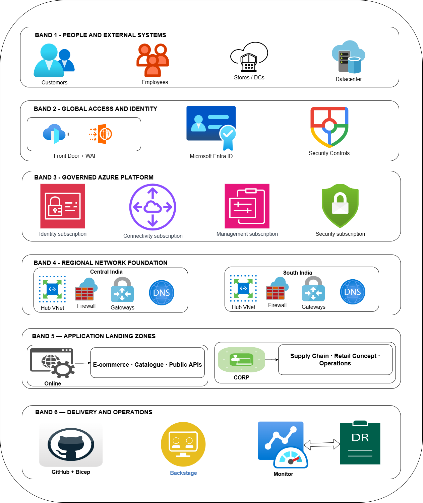

# 1. Architecture assumptions and production decisions

## Retailer production baseline

| Category | Baseline |
|---|---|
| Business units | Range, Supply Chain, Retail Concept, Operations |
| Azure regions | Central India primary; South India secondary, subject to service availability, data-residency requirements and tested recovery objectives |
| Public workloads | E-commerce, product catalogue, public APIs |
| Internal workloads | Merchandising, warehouse management, store operations, planning and reporting |
| Data classification | Public catalogue data; confidential inventory/pricing; restricted customer and transaction data |
| Connectivity | Redundant enterprise WAN/SD-WAN, ExpressRoute as primary hybrid connectivity where justified, VPN as backup or initial connectivity option |
| Availability targets | Illustrative application SLO of 99.95% for public commerce and 99.9% for internal applications |
| Recovery objectives | Tier 1: target RTO 60 minutes, RPO 5 minutes; other workloads classified individually |
| Infrastructure as code | Bicep, GitHub Actions, approved modules and automated policy validation |
| Developer platform | Backstage portal, software templates, service catalog and self-service deployment workflows |

These are design assumptions, not guaranteed Azure SLAs. The final architecture must be validated against application dependencies, regional service availability, network capacity, licensing, business impact analysis and the actual data replication mechanism.

### Core architectural decisions
- Management groups and subscriptions organize governance and ownership; they are not a substitute for network or application isolation.
- A shared platform foundation provides identity integration, connectivity, security and operational management.
- Online and Corp landing zones separate internet-facing workloads from internal enterprise workloads; add restricted-data controls where needed.
- Regional hubs provide controlled connectivity in both Azure regions, while global ingress directs public traffic to healthy regional endpoints.
- Managed PaaS first for suitable application workloads; use AKS only where its capabilities justify its operational overhead.
- Data recovery is designed separately from application recovery. Deploying a second application instance does not guarantee a consistent or recoverable database.

---

# master diagram in draw.io - Use this as the initial layout

